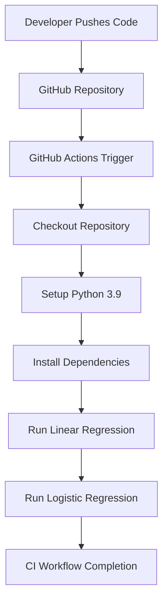

# 🚀 MLForge-CI

**A Python-based Machine Learning and Continuous Integration project using Scikit-learn and GitHub Actions.**

[](https://www.python.org/)
[](https://scikit-learn.org/)
[](https://github.com/features/actions)

## 📌 Overview

MLForge-CI is a beginner-friendly project demonstrating how machine learning models can be developed using Python and automatically executed through a Continuous Integration (CI) pipeline.

The repository contains implementations of Linear Regression and Logistic Regression using Scikit-learn, along with a GitHub Actions workflow that automatically installs dependencies and executes both scripts whenever code is pushed.

## ✨ Key Features

- **Linear Regression:** Demonstrates regression model training and prediction.
- **Logistic Regression:** Demonstrates binary classification and probability prediction.
- **Automated CI Pipeline:** Executes Python scripts automatically through GitHub Actions.
- **Dependency Management:** Uses a requirements file to manage Python libraries.
- **Reproducible Workflow:** Provides a simple foundation for machine learning automation.

## 🏗️ Project Architecture



## 📂 Repository Structure

```text
MLForge-CI/
│
├── linear-regression.py
├── logistic-regression.py
├── ml_pipeline.yml
├── requirements.txt
└── README.md
```

## 🧰 Technology Stack

| Technology | Purpose |
|---|---|
| Python | Programming language |
| NumPy | Numerical computing |
| Pandas | Data handling |
| Scikit-learn | Machine learning algorithms |
| GitHub Actions | Continuous integration |
| YAML | Pipeline configuration |

## 🤖 Machine Learning Implementations

### 1. Linear Regression

The Linear Regression implementation uses Scikit-learn to train a regression model on a small sample dataset.

**Workflow:**
- Define input features and target values.
- Train a Linear Regression model.
- Generate a prediction for a new input.

### 2. Logistic Regression

The Logistic Regression implementation demonstrates binary classification.

**Workflow:**
- Define sample features and binary labels.
- Train a Logistic Regression model.
- Predict the class of a new input.
- Display the probability distribution.

*Note: Both implementations currently use small illustrative datasets for demonstration purposes, not real-world model evaluation.*

## ⚙️ Installation and Setup

### Prerequisites

- Python 3.9 or later
- Git
- pip

### Step 1: Clone the Repository

```bash
git clone https://github.com/sonaltalekar1203-web/mlops-lab.git
cd mlops-lab
```

### Step 2: Create a Virtual Environment

```bash
python -m venv venv
```

Activate it on Windows:

```bash
venv\Scripts\activate
```

### Step 3: Install Dependencies

```bash
pip install -r requirements.txt
```

### Step 4: Run Linear Regression

```bash
python linear-regression.py
```

### Step 5: Run Logistic Regression

```bash
python logistic-regression.py
```

## 🔄 Continuous Integration with GitHub Actions

The project uses a GitHub Actions workflow defined in `ml_pipeline.yml`.

The workflow is triggered whenever code is pushed to the repository.

**Pipeline stages:**

1. Checkout repository.
2. Set up Python 3.9.
3. Install required dependencies.
4. Execute Linear Regression.
5. Execute Logistic Regression.

Workflow execution results can be viewed under the **Actions** tab of the GitHub repository.

## 🔮 Future Enhancements

- Add automated unit testing.
- Integrate data preprocessing and validation.
- Introduce model evaluation metrics.
- Implement experiment tracking.
- Add model serialization and versioning.
- Build a FastAPI model deployment service.
- Introduce model monitoring and performance tracking.
- Expand the CI workflow into a complete ML training and deployment pipeline.

## 🎯 Project Objective

The objective of MLForge-CI is to establish a foundation for understanding machine learning development and automation, while exploring how CI practices can improve the consistency and reliability of ML workflows.

## 👥 Authors

| Author | GitHub Profile |
|---|---|
| **Anuj P.** | [@anujp012](https://github.com/anujp012) |
| **Arjun Talekar** | [@sonaltalekar1203-web](https://github.com/sonaltalekar1203-web) |
| **Mainuddin Sable** | [@Mainuddin-sable](https://github.com/Mainuddin-sable) |

Developed collaboratively by the authors listed above.

## 📄 License

No license is currently specified for this repository.

---

<p align="center">
  <b>MLForge-CI</b><br>
  Machine Learning • Python • Automation • CI/CD
</p>
